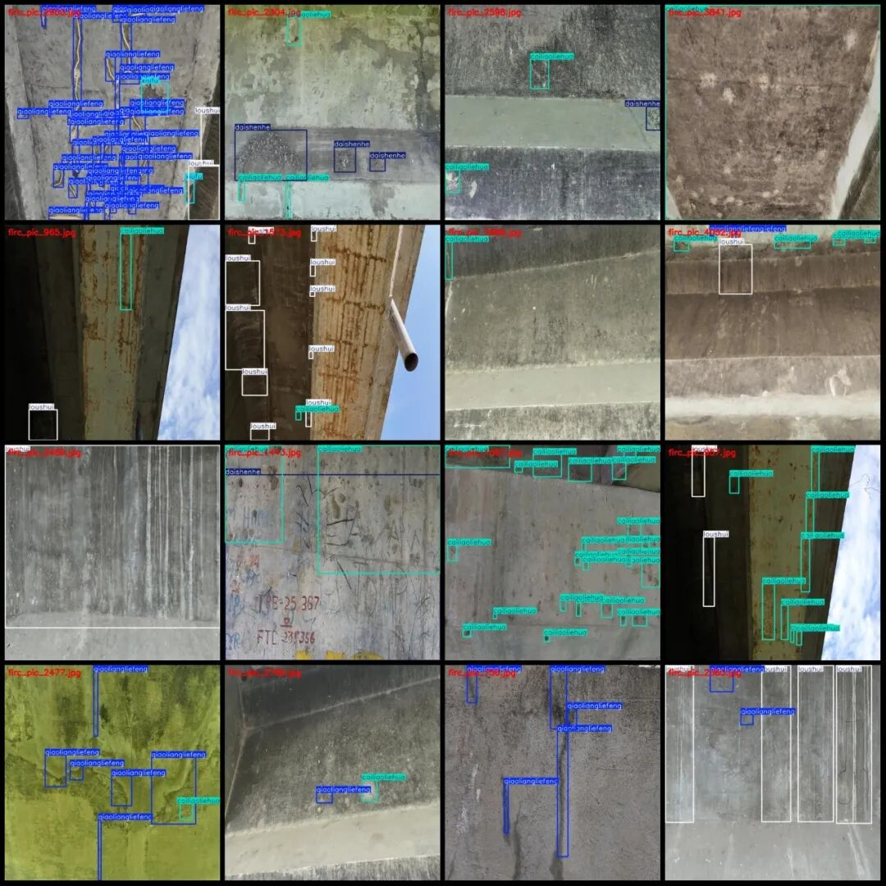
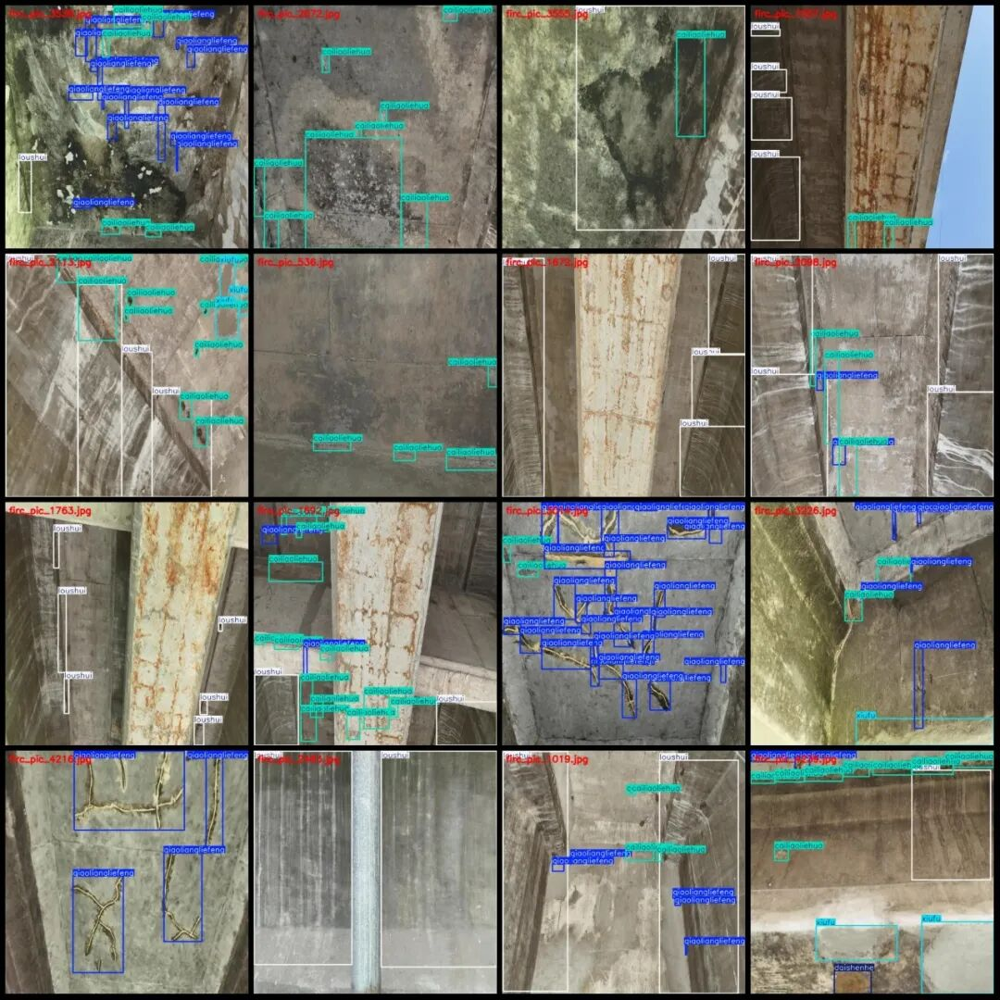

# Bridge Structure Deterioration Identification and Detection Dataset VOC+YOLO format: 4321 images, 5 categories

Note that the images in the dataset are many video clips that have been extracted frames, so they appear to be repeated (in reality, the images are not repeated).

Dataset format: Pascal VOC format + YOLO format (txt file without split path, only containing jpg images and corresponding VOC format xml files and yolo format txt files)

Number of images (number of jpg files): 4321

Number of annotations (number of xml files): 4321

Number of annotations (number of txt files): 4321

Label category count: 5

Label category names (Note that the order of categories in the YOLO format does not correspond to this, but is based on the labels folder's classes.txt): ["cailiaoliehua", "daishenhe", "loushui", "qiaoliangliefeng", "xiufu"]

Material degradation, pending review, leakage, bridge cracks, repair

Number of boxes labeled in each category:

cailiaoliehua frame count = 14733

Daishenhe Frame Count = 2089

Loushui Frames = 4629

qiaoliangliefeng frame count = 18773

Xiufu Frame Count = 1535

Total frame count: 41759

Number of images per category:

cailiaoliehua occupies = 2698

Daishenhe's possession of images = 868

Loushui owns 1847 images.

qiaoliangliefeng occupies = 2069

Xiufu owns 584 images.

Image resolution: 640x640

Using labelImg:

Annotation rules: Draw a rectangle around the category.

Important Notice: The dataset does not have separate training, validation, and test sets; you need to partition them yourself.

Special : This dataset does not guarantee the accuracy of the trained models or weight files.

Image Preview:

Annotation example:

## Payment

Here is a pay link on Stripe ( https://buy.stripe.com/3cs8yP7sY87d0vu9AB ). Please contact me lonlonago@foxmail.com after funding $89, and I will send you a complete data files , thank you!

